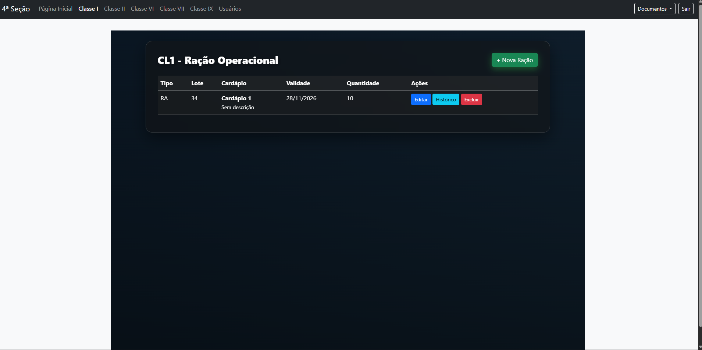
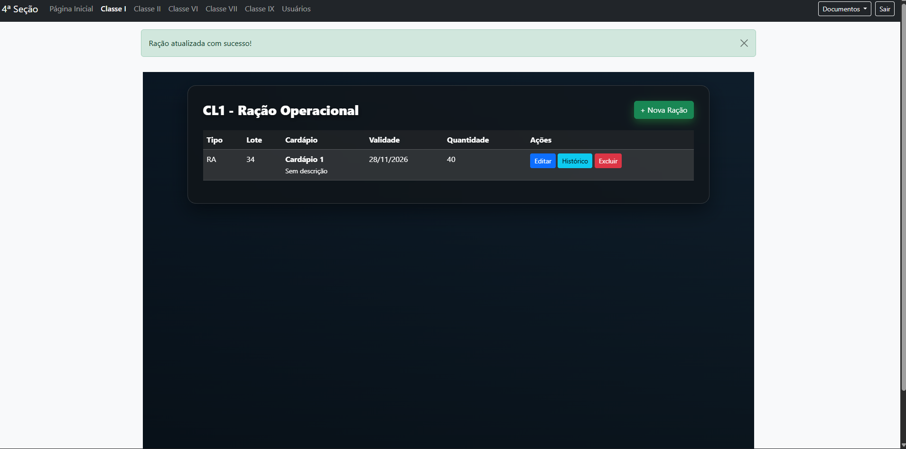

# Sistema de Controle de Material · Portfólio

Aplicação Flask para inventário, disponibilidade e histórico de alterações por classe de material.

## Demonstração

O sistema reúne inventário, disponibilidade e acesso por classe de material. Neste cenário de demonstração, o recebimento de 30 unidades elevou o saldo do lote de 10 para 40.

### Inventário



### Histórico de alterações

O histórico registra a data, o usuário responsável, o motivo e os valores antes e depois da edição.



## Como rodar

```sh
python -m venv .venv
source .venv/bin/activate
pip install -r requirements.txt
export SECRET_KEY="$(openssl rand -hex 32)"
flask --app wsgi:app db upgrade
flask --app wsgi:app run --host 0.0.0.0 --port 5000
```

Com o banco migrado, rode `flask --app wsgi:app shell` e execute `from getpass import getpass; from app.models import db, User; u = User(full_name="Admin Demo", username="demo", role="admin", active=True); u.set_password(getpass()); db.session.add(u); db.session.commit()` para criar a conta local de demonstração. Defina `SECRET_KEY` no ambiente para manter as sessões entre reinícios.

No Codespaces, abra a porta **5000** pela aba **Portas**, com visibilidade **Privada**. Use a conta `demo` e a senha que você definiu.
